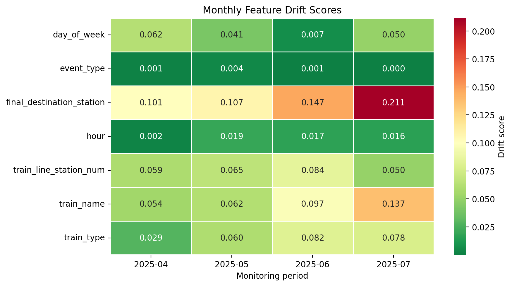
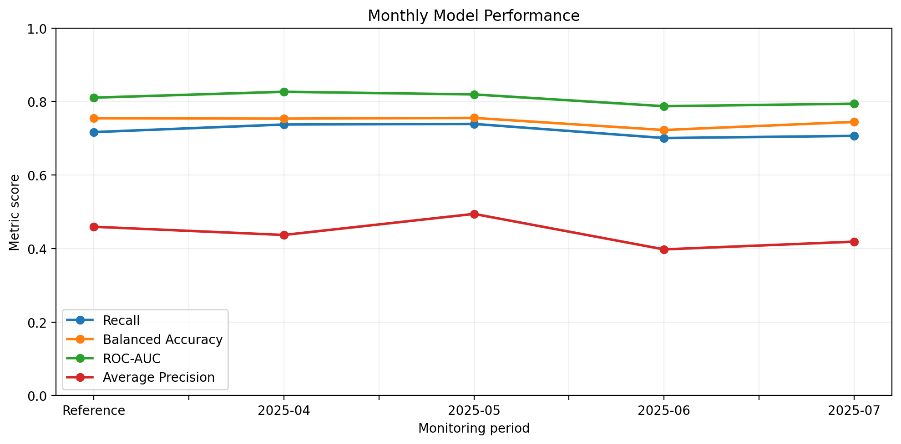
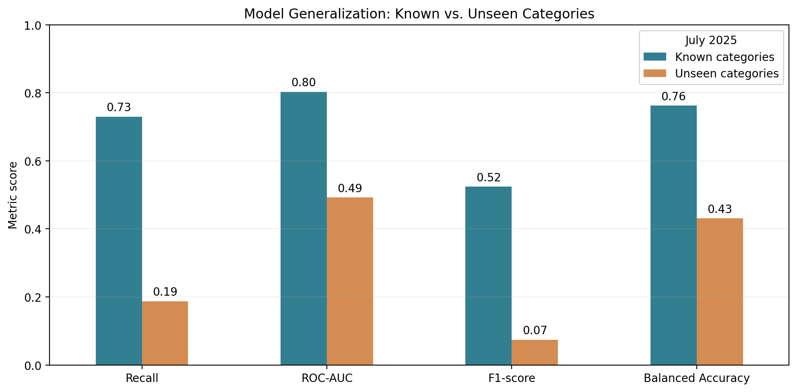

# Railway Delay Prediction: Model Monitoring & Drift Detection

**Tübingen, Germany | Stage 3**

This project extends the previous railway delay analysis and predictive modeling studies toward MLOps and model monitoring, investigating how a predictive model behaves as operational data changes over time.

Rather than focusing exclusively on predictive accuracy, this stage examines model stability, changes in data distributions, generalization risks, and the identification of potential performance degradation.

**Related projects:** [Stage 1 – Railway Delay Analysis](https://github.com/Vanessa22400/Railway_Delay-Analysis_DB) | [Stage 2 – Prediction & Explainability](../README.md)

---

## Project at a Glance

| Indicator | Result |
|---|---:|
| Historical railway observations | 24,649 |
| Monitoring windows | 4 months |
| Reference ROC-AUC | 0.8112 |
| Reference recall | 71.52% |
| Features monitored | 7 |

*Feature-level drift monitoring across four monthly windows using Evidently AI.*

---

## Problem Statement

A predictive model may perform well during initial validation but become less reliable as operational conditions change.

Can historical monitoring identify changes in railway service distributions, predictive performance, and model generalization before aggregate indicators reveal potential problems?

---

## Dataset

The study uses historical Deutsche Bahn railway data from [Hugging Face](https://huggingface.co/datasets/piebro/deutsche-bahn-data), focusing on Tübingen Hauptbahnhof between August 2024 and July 2025.

- 24,649 non-canceled railway observations
- Weekday railway operations
- Scheduled temporal and operational features
- Binary classification target: critical delays exceeding five minutes

Unlike the previous modeling stages, this experiment adopts chronological validation and retains negative delays as non-critical observations.

---

## Objectives

- Establish an independent, out-of-sample performance baseline.
- Detect feature, target, and prediction drift using Evidently AI.
- Monitor predictive performance across subsequent periods.
- Investigate generalization risks associated with previously unseen categories.
- Develop a reusable batch monitoring pipeline with exploratory alert rules.

---

## Methodology

1. **Data Quality & Leakage Assessment:** validation of scheduled timestamps and exclusion of post-event information from predictive features.
2. **Temporal Validation:** chronological separation into training, reference, and monitoring datasets.
3. **Predictive Modeling:** Random Forest classification with integrated preprocessing and class weighting.
4. **Drift Detection:** normalized Wasserstein distance and Jensen-Shannon distance using Evidently AI.
5. **Performance Monitoring:** evaluation of classification metrics and segment-level performance.
6. **Monitoring Pipeline:** integration of drift indicators, performance metrics, unseen category detection, alert rules, and report export.

### Temporal Validation

| Dataset | Period | Records |
|---|---|---:|
| Training | Aug 2024 – Jan 2025 | 11,449 |
| Reference | Feb – Mar 2025 | 4,345 |
| Monitoring | Apr – Jul 2025 | 8,855 |

The model remains fixed throughout the monitoring period.

---

## Key Findings

### 1. Persistent Feature Drift

Final destination distributions exhibit persistent and progressively increasing drift, with Jensen-Shannon distance rising from 0.1008 in April to 0.2115 in July.

Train name distributions also exceed the drift threshold in July. However, dataset-level drift is not flagged in any monitoring window.

This highlights the importance of monitoring individual features alongside aggregate indicators.

### 2. Predictive Performance Over Time

June presents the largest observed performance deterioration, accompanied by prediction score drift.

Performance partially recovers in July despite increasing operational feature drift, illustrating that distribution shifts and predictive degradation do not necessarily evolve together.

### 3. Generalization to Unseen Categories

In July, 8.71% of observations contain at least one categorical value absent from the training dataset.

| Metric | Known categories | Unseen categories |
|---|---:|---:|
| Observations | 2,159 | 206 |
| Recall | 72.16% | 25.00% |
| ROC-AUC | 0.8053 | 0.4980 |
| F1-score | 0.5194 | 0.0920 |

The segment-level analysis reveals a potential generalization weakness that aggregate performance metrics may obscure. The smaller sample size and limited number of critical delays in this segment require cautious interpretation.

---

## Monitoring Pipeline & Alerts

The implemented batch monitoring workflow combines:

- Feature-level and dataset-level drift detection
- Target and prediction drift monitoring
- Predictive performance evaluation
- Unseen category detection
- Rule-based monitoring alerts
- Consistency checks and report export

The workflow generates structured CSV outputs and interactive Evidently HTML reports for further investigation.

**Monitoring artifacts:**

- [Monthly Monitoring Summary](reports/monitoring_summary.csv)
- [Monitoring Alerts](reports/monitoring_alerts.csv)
- [Feature Drift Report – July](reports/feature_drift_july.html)
- [Prediction Drift Report – June](reports/prediction_drift_june.html)

HTML reports can be downloaded and opened locally in a browser.

---

## Tools & Technologies

- Python (Pandas, NumPy)
- Scikit-learn (Random Forest, Pipeline, ColumnTransformer)
- Evidently AI 0.7.23
- Statistical Drift Detection
- Matplotlib, Seaborn
- Google Colab

---

## Limitations

This project represents a retrospective, offline monitoring experiment rather than a deployed production system.

The dataset covers one railway station and one annual cycle of weekday operations. Monitoring thresholds are exploratory, and observed performance differences do not establish causality or demonstrate concept drift.

Future operational implementation would require prospective validation, automated monitoring schedules, and validated retraining criteria.

---

## Strategic Perspective

The previous stages of this project investigated why railway delays occur and how they can be predicted. This extension adds another question: how reliable do those predictions remain as operational conditions change?

The findings reinforce the importance of evaluating models beyond their initial performance, combining distribution monitoring, predictive quality, and segment-level analysis to support more informed model maintenance decisions.

---

## Notebook & Reproducibility

[View the complete Model Monitoring notebook](Deutsche_Bahn_Model_Monitoring.ipynb)

The notebook includes data preparation, chronological model validation, drift detection, performance monitoring, alert generation, and report export.

To reproduce the analysis in Google Colab, obtain the curated railway dataset from the original project, configure the local dataset path, and install the specified Evidently AI version.
